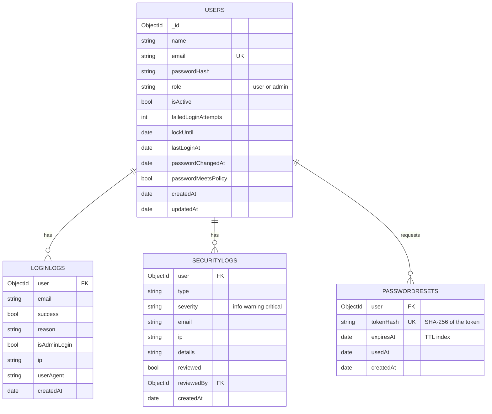

# Database: `keyfortDB`

A fifth collection, `sessions`, is created automatically by `connect-mongo` to hold login sessions (it expires them itself).

Indexes: unique `users.email`; `users.role`, `isActive`, `lockUntil`, `name`; `loginlogs.createdAt`, `user+createdAt`, `email`, `ip`, `success`; `securitylogs.createdAt`, `type`, `severity`, `reviewed`; `passwordresets.tokenHash` (unique) and a TTL index on `expiresAt`.
Raw passwords and raw reset tokens are never stored.
