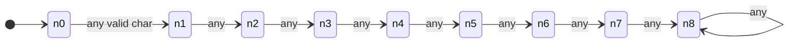
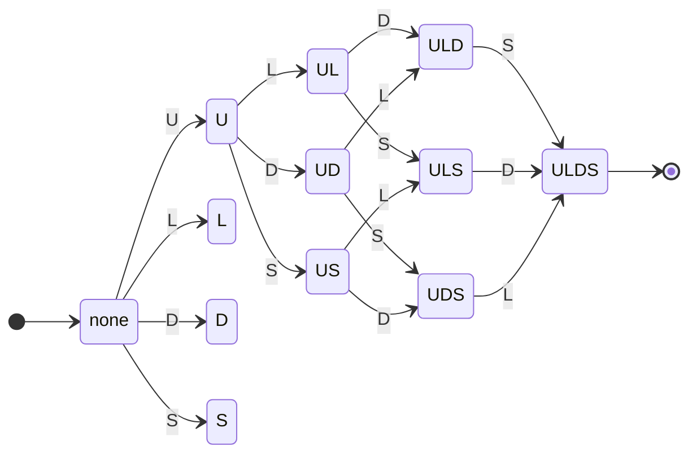

# DFA design for the KeyFort password policy

Source: `backend/services/dfaEngine.js` (automaton) and `backend/services/passwordValidator.js` (regular expressions + comparison).

## Formal definition

`M = (Q, Σ, δ, q0, F)`

| Part | Definition |
|---|---|
| Σ | `U` uppercase A-Z, `L` lowercase a-z, `D` digit 0-9, `S` special (every other character, including space and non-ASCII symbols), `X` invalid control character (code < 32 or 127) |
| Q | `q<n>:<flags>` where `n` = characters read, capped at 8, and `flags` has four positions `U L D S` showing the letter once that category was seen, otherwise `-`. Plus the trap state `q_dead`. 9 x 16 + 1 = **145 states** |
| q0 | `q0:----` |
| F | `{ q8:ULDS }`, meaning length reached 8 **and** all four categories were seen |
| δ(q, c) | `q_dead` if `q = q_dead` or `c = X`; otherwise `n' = min(n+1, 8)` and the category of `c` is added to `flags` |

Accepting means: length >= 8 and at least one uppercase, lowercase, digit and special character.
Rejecting means: any other final state, or `q_dead`.
The 128-character maximum is an input-size limit applied before and beside the DFA.

## The two component automata

The 145-state machine is the product of a length counter and a category tracker.

Length counter (saturates at 8):



Category tracker (each of U, L, D, S is a switch that turns on and never turns off; the machine accepts when all four are on):



(The diagram shows the order-independent growth of the flag set; the full machine has all 16 subsets and also loops on repeated categories. Any `X` symbol from any state goes to `q_dead`.)

## Worked trace: `Fort#2026`

| # | char | symbol | from | to |
|---|---|---|---|---|
| 1 | F | U | q0:---- | q1:U--- |
| 2 | o | L | q1:U--- | q2:UL-- |
| 3 | r | L | q2:UL-- | q3:UL-- |
| 4 | t | L | q3:UL-- | q4:UL-- |
| 5 | # | S | q4:UL-- | q5:UL-S |
| 6 | 2 | D | q5:UL-S | q6:ULDS |
| 7 | 0 | D | q6:ULDS | q7:ULDS |
| 8 | 2 | D | q7:ULDS | q8:ULDS |
| 9 | 6 | D | q8:ULDS | q8:ULDS |

Final state `q8:ULDS` is accepting, so the result is **ACCEPT**. The regular expression gives the same result.

## Regular expressions used

```
min length   ^.{8,}$                (flags s,u)
uppercase    [A-Z]
lowercase    [a-z]
digit        [0-9]
special      [^A-Za-z0-9]
no control   ^(?!.*[\x00-\x1F\x7F]).*$
combined     ^(?=.*[A-Z])(?=.*[a-z])(?=.*[0-9])(?=.*[^A-Za-z0-9])(?!.*[\x00-\x1F\x7F]).{8,}$
```

## DFA versus regex

Both describe the same regular language. `backend/tests/dfa.test.js` runs 20,000 random strings (including control characters, accented letters and symbols) and asserts the two always agree. The public API returns both verdicts and a `comparison.consistent` flag.

## Test cases

| Password | Expected | Reason |
|---|---|---|
| `Abcdef1!` | ACCEPT | all rules |
| `KeyFort@2026` | ACCEPT | all rules |
| `Zx9#kLm2$Qw` | ACCEPT | all rules |
| `Hello World 9!` | ACCEPT | space counts as special |
| (empty) | REJECT | too short |
| `Ab1!` | REJECT | 4 characters |
| `abcdefg1!` | REJECT | no uppercase |
| `ABCDEFG1!` | REJECT | no lowercase |
| `Abcdefgh!` | REJECT | no digit |
| `Abcdefg12` | REJECT | no special |
| `Abc1!` + NUL + `xyz` | REJECT | control character leads to `q_dead` |

Strength labels (separate from the policy verdict): Weak = fails the policy or is common/predictable; Medium = passes the policy but is under 12 characters or has a repeat/sequence; Strong = passes, 12+ characters, 8+ unique characters, no sequence or repeat.
