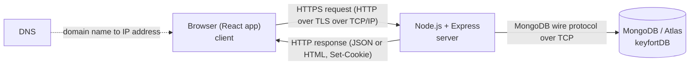
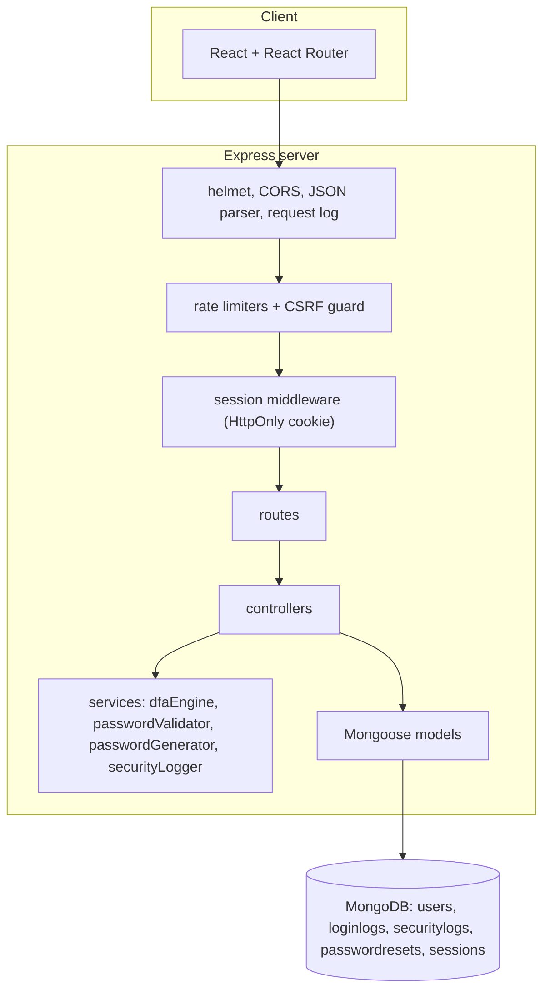

# Network and security demonstration (Computer Networks)

## Client-server architecture



## System architecture



## What is implemented and where

| Concept | Implementation |
|---|---|
| Client-server model | React browser client and Express server are separate programs that communicate only through the API |
| HTTP request and response | Methods, status codes (200, 201, 400, 401, 403, 409, 423, 429), headers, cookies, JSON bodies. The **Network lab** page shows a live request, connection and response headers (`GET /api/network/info`) |
| REST API | Resource-style endpoints, see API.md |
| TCP/IP | The operating system implements TCP/IP. Node.js uses it through socket APIs (`http.createServer`). KeyFort does **not** implement the TCP protocol itself. The Network lab shows the TCP endpoints (client and server address and port) of the real connection |
| HTTPS/TLS | Production cookies are `Secure`, HSTS and `upgrade-insecure-requests` are enabled. TLS is normally terminated by the host or a proxy (`TRUST_PROXY=1`), or by Node directly when `HTTPS_KEY_PATH` / `HTTPS_CERT_PATH` are set (TLS 1.2 minimum) |
| DNS and domain readiness | `CLIENT_URL`, `PUBLIC_APP_URL`, CORS allow-list, DEPLOYMENT.md DNS steps |
| Network-based login monitoring | Each login attempt stores IP address and user agent. Admin "Suspicious activity" groups failures by IP and by account |
| Rate limiting | `express-rate-limit` per IP: global, login/register, password reset, public checker. Hits return 429 and create `RATE_LIMIT_HIT` events |

## Security controls

| Control | Detail |
|---|---|
| Password storage | bcrypt (bcryptjs), cost 12, unique salt per hash |
| Sessions | server-side sessions in MongoDB, cookie `keyfort.sid`: HttpOnly, SameSite, Secure in production, rolling expiry, session id regenerated at login, destroyed at logout |
| CSRF | custom header `X-Requested-With: KeyFort` required on every state-changing request plus a CORS allow-list |
| Brute force | per-IP rate limits and per-account lock: 5 failures lock for 15 minutes (configurable) |
| User enumeration | same message for unknown email and wrong password; password reset always answers the same; dummy hash comparison equalises timing |
| Password reset | 32-byte random token, only its SHA-256 hash stored, 30-minute expiry, single use, TTL index cleans up, all sessions revoked after use |
| Authorization | `requireAuth` re-reads the user (role and active flag) from the database on every request; `requireAdmin` guards all `/api/admin` routes; denials are logged |
| Input handling | type checks on every field (blocks NoSQL operator injection), body limit 10 KB, regex input escaped for search |
| Headers | helmet: Content-Security-Policy, X-Content-Type-Options, X-Frame-Options (frame-ancestors none), Referrer-Policy, HSTS in production |
| Secrets | `.env` only, `.env.example` has no secrets, no default admin, first admin created through a prompt or environment variables |
| Logging | request logs contain method, path and status only. Passwords and reset tokens are never logged. The public checker keeps nothing and answers with `Cache-Control: no-store` |

## Self-signed certificate for local HTTPS testing (optional)

With OpenSSL installed (it ships with Git for Windows):
```
mkdir backend\certs
openssl req -x509 -newkey rsa:2048 -nodes -keyout backend/certs/localhost-key.pem -out backend/certs/localhost-cert.pem -days 365 -subj "/CN=localhost"
```
Add to `backend/.env`:
```
HTTPS_KEY_PATH=./certs/localhost-key.pem
HTTPS_CERT_PATH=./certs/localhost-cert.pem
COOKIE_SECURE=true
CLIENT_URL=https://localhost:5000
```
Then open `https://localhost:5000` and accept the browser warning. Note: STOP-KEYFORT.bat falls back to ending the process by its recorded PID in HTTPS mode.
